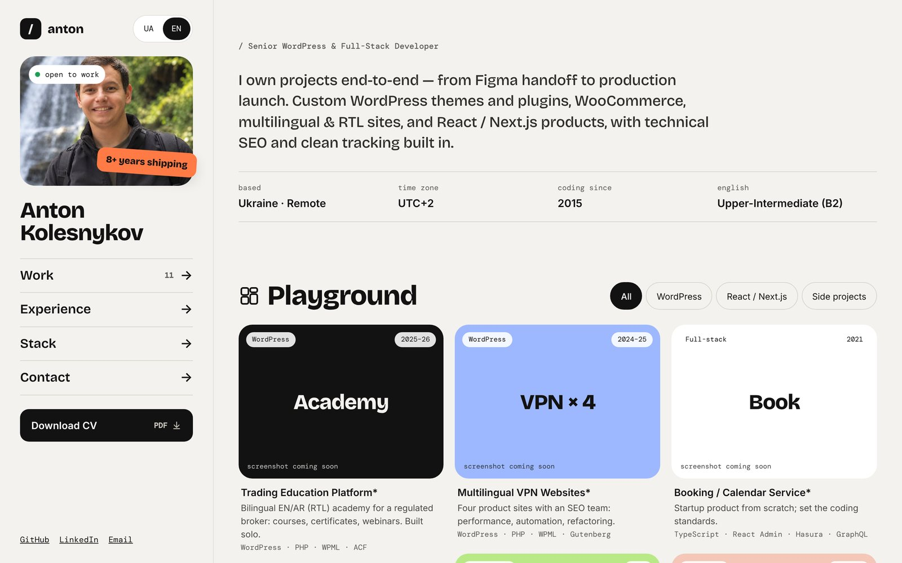
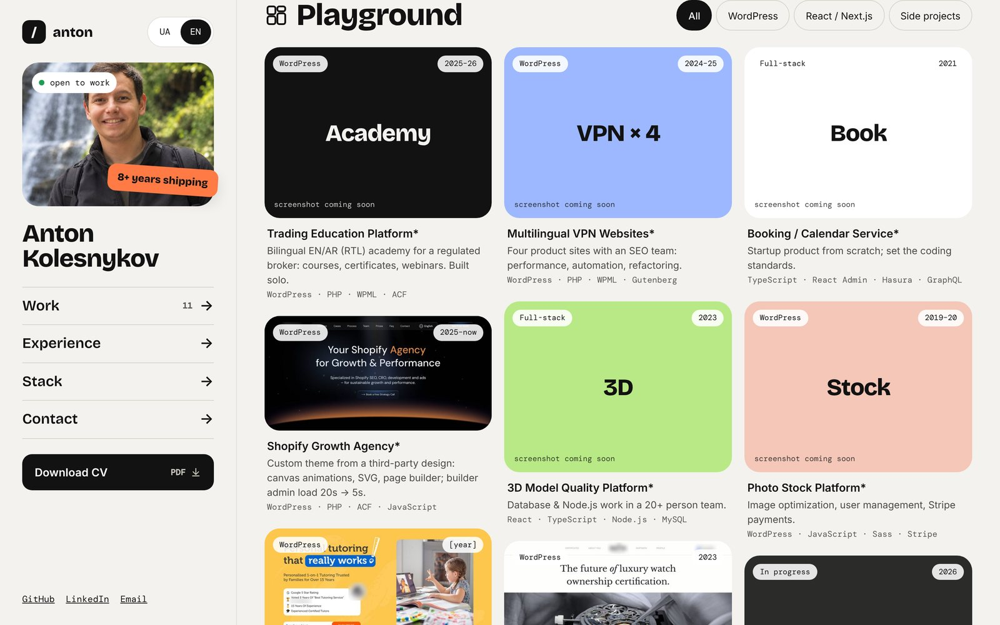
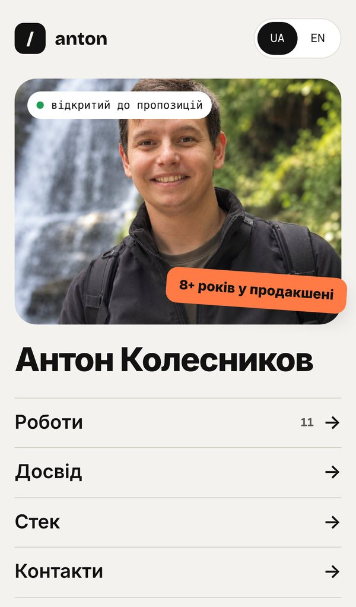

# runo94.github.io

Portfolio of Anton Kolesnykov — Senior WordPress & Full-Stack Developer.
Built with Vite + TypeScript + SCSS, deployed to GitHub Pages with GitHub Actions.

**Live:** https://runo94.github.io



<table>
  <tr>
    <td width="40%"></td>
    <td width="40%"></td>
    <td width="20%"></td>
  </tr>
  <tr>
    <td align="center">Projects &amp; filters</td>
    <td align="center">Project details</td>
    <td align="center">Mobile · UA</td>
  </tr>
</table>

## Features

- Fixed sidebar layout that stacks above the content on phones
- Ukrainian / English switch (remembers the choice, supports `?lang=uk|en`)
- Filterable project grid with a details dialog: role, highlights, result, stack and extra screenshots
- Keyboard friendly: native `<dialog>`, Esc to close, ← → to flip projects
- Self-hosted fonts (Fontsource), no external requests
- Open Graph tags and `Person` structured data

## Develop

```bash
npm install
npm run dev        # http://localhost:5173
npm run build      # type-check + production build into dist/
npm run preview    # serve the built site locally
```

## Where things live

| Path | What it holds |
| --- | --- |
| `src/data/projects.ts` | Portfolio projects: copy (UA/EN), stack, covers, gallery screenshots |
| `src/data/content.ts` | Interface copy, experience, stack groups, contact links |
| `src/scripts/render.ts` | HTML templates for the sidebar, sections and project dialog |
| `src/main.ts` | Page state: language, project filter, open project |
| `src/styles/` | SCSS: tokens, sidebar, sections, dialog |
| `public/images/` | Photo, project covers and gallery screenshots |
| `public/cv/` | Downloadable CV |
| `docs/` | Screenshots used in this README (not deployed) |

### Adding a project

Add an entry to `src/data/projects.ts`. Put the cover in `public/images/projects/`
(a ~720px wide `-tile.jpg` for the grid and a ~1200px version for the dialog) and extra
screens in `public/images/gallery/`. Client work is under NDA: anonymize names and blur logos.

## Deploy

Pushing to `master` runs `.github/workflows/deploy.yml`, which builds the site and publishes `dist/`.
One-time setup: **Settings → Pages → Build and deployment → Source: GitHub Actions**.
